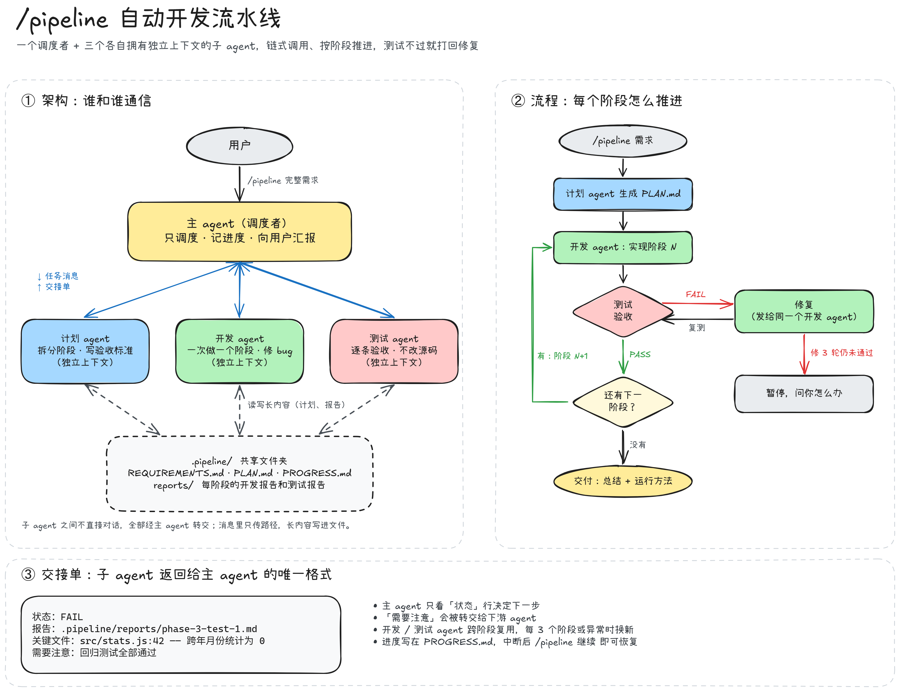

<div align="center">

# Claude Pipeline Skill

**一行命令，把 Claude Code 会话变成一个「计划 → 开发 → 测试」的自动开发小队。**

[](https://github.com/ELjagi623/claude-pipeline-skill/releases/latest)
[](https://docs.claude.com/en/docs/claude-code)

[安装](#安装) · [让 AI agent 帮你装](#让-ai-agent-帮你安装) · [使用](#使用) · [工作原理](#工作原理) · [设计文档](docs/设计说明.md)

</div>

---

输入 `/pipeline <完整需求>`，当前会话就切换成**调度者**。它先让计划 agent 把需求拆成若干阶段，然后逐个阶段交给开发 agent 实现、交给测试 agent 独立验收；测试不通过就打回修复、再测，直到全部阶段通过后交付。

三个子 agent 各自拥有**独立的上下文窗口**，按顺序链式调用，不并发。不输入 `/pipeline` 时，这套流程完全不生效，会话照常使用。

<p align="center">
  
</p>

<p align="center"><sub>源文件 <a href="docs/pipeline-diagram.excalidraw">docs/pipeline-diagram.excalidraw</a>，可在 <a href="https://excalidraw.com">excalidraw.com</a> 打开编辑</sub></p>

## 特性

- **开关式**：只有你手动输入 `/pipeline` 才会启动，模型不会自行触发。
- **职责隔离**：调度者只调度；测试 agent 不能改源码，验收保持独立。
- **独立上下文**：每个子 agent 自己的对话互不干扰，主 agent 只收到几行交接单。
- **跨阶段复用 + 自动轮换**：开发和测试 agent 默认沿用以保留上下文，连续服务 3 个阶段或状态异常时自动换新。
- **可中断、可恢复**：所有进度写在项目的 `.pipeline/` 文件夹里，换会话也能用 `/pipeline 继续` 接着跑。
- **防死循环**：同一阶段修复 3 轮仍不通过就停下来问你。

## 前置条件

- 已安装 [Claude Code](https://docs.claude.com/en/docs/claude-code)（命令行、桌面版或 IDE 插件均可）。
- 一键安装需要 `curl`（macOS / Linux）或 PowerShell（Windows，系统自带）。

## 安装

安装位置是用户级配置目录 `~/.claude/`，装一次所有项目都能用。已存在的同名文件会先自动备份为 `*.bak.<时间戳>`。

### 方式一：一行命令（推荐）

**macOS / Linux**

```bash
curl -fsSL https://raw.githubusercontent.com/ELjagi623/claude-pipeline-skill/main/install.sh | bash
```

**Windows（PowerShell）**

```powershell
irm https://raw.githubusercontent.com/ELjagi623/claude-pipeline-skill/main/install.ps1 | iex
```

### 方式二：下载 Release

1. 下载 [claude-pipeline-skill.zip](https://github.com/ELjagi623/claude-pipeline-skill/releases/latest/download/claude-pipeline-skill.zip) 并解压。
2. 在解压出来的文件夹里运行：
   - macOS / Linux：`bash install.sh`
   - Windows：`powershell -ExecutionPolicy Bypass -File .\install.ps1`

### 方式三：手动复制

| 仓库中的文件 | 复制到 |
|---|---|
| `skills/pipeline/SKILL.md` | `~/.claude/skills/pipeline/SKILL.md` |
| `agents/pipeline-planner.md` | `~/.claude/agents/pipeline-planner.md` |
| `agents/pipeline-developer.md` | `~/.claude/agents/pipeline-developer.md` |
| `agents/pipeline-tester.md` | `~/.claude/agents/pipeline-tester.md` |

> [!TIP]
> 只想在某一个项目里用？把上面四个文件复制到**该项目**的 `.claude/skills/pipeline/` 和 `.claude/agents/` 下即可，不影响其他项目。

> [!IMPORTANT]
> 安装后需要**新开一个 Claude Code 会话**，新的 skill 和子 agent 才会被识别。

## 让 AI agent 帮你安装

把这个仓库地址发给你的 Claude Code（或其他能执行命令的 AI agent），说一句「帮我安装这个」即可：

```text
https://github.com/ELjagi623/claude-pipeline-skill 帮我安装这个
```

### 给 AI agent 的安装说明

> 如果你是正在阅读本文件的 AI agent，用户希望你安装这个 skill，请按以下步骤执行：

1. **判断系统**，运行对应的一条命令（会把 4 个文件下载并安装到用户的 Claude Code 配置目录）：
   - macOS / Linux / Windows 上的 Git Bash：
     `curl -fsSL https://raw.githubusercontent.com/ELjagi623/claude-pipeline-skill/main/install.sh | bash`
   - Windows PowerShell：
     `irm https://raw.githubusercontent.com/ELjagi623/claude-pipeline-skill/main/install.ps1 | iex`
2. **校验**下面 4 个文件都已存在（`~` 为用户主目录；若设置了环境变量 `CLAUDE_CONFIG_DIR`，则以它代替 `~/.claude`）：
   - `~/.claude/skills/pipeline/SKILL.md`
   - `~/.claude/agents/pipeline-planner.md`
   - `~/.claude/agents/pipeline-developer.md`
   - `~/.claude/agents/pipeline-tester.md`
3. 如果无法联网下载，改用[方式三](#方式三手动复制)：从本仓库读取这 4 个文件，按表格原样写入目标路径。写入前若目标文件已存在，先备份。
4. **告诉用户**：安装完成，需要新开一个 Claude Code 会话，然后输入 `/pipeline <完整需求>` 启动。
5. 不要修改这 4 个文件的内容，也不要运行 `/pipeline`，除非用户要求。

## 使用

在项目文件夹里新开会话，然后：

| 命令 | 作用 |
|---|---|
| `/pipeline <完整需求>` | 开启新流水线 |
| `/pipeline 状态` | 查看进度（不派任何 agent） |
| `/pipeline 停止` | 暂停 |
| `/pipeline 继续` | 从中断处恢复，换了会话也行 |

示例：

```text
/pipeline 做一个记账网页：可以添加收入和支出、按月统计、数据保存在浏览器本地，用原生 HTML/CSS/JS，不要后端。
```

需求写得越具体（功能、技术栈偏好、如何验收），计划越准确。

> [!TIP]
> 想让它无人值守地跑完，把 Claude Code 的权限模式切到 **auto**，否则每遇到需要审批的操作都会停下来等你。

正常情况下它会一路跑完。以下情况会暂停并询问你：计划中有影响方向的假设需要确认、开发 agent 认为计划行不通（`BLOCKED`）、某阶段修复 3 轮仍未通过。

## 工作原理

| 角色 | 文件 | 职责 |
|---|---|---|
| 调度者 | `skills/pipeline/SKILL.md` | 派活、判定结果、记录进度、向你汇报。不写代码。 |
| 计划 | `agents/pipeline-planner.md` | 把需求拆成按顺序执行的阶段，每阶段写清可验证的验收标准。 |
| 开发 | `agents/pipeline-developer.md` | 每次只实现一个阶段；按测试报告找根因修复。 |
| 测试 | `agents/pipeline-tester.md` | 逐条验收 + 回归测试，给出 PASS / FAIL。不改源码。 |

agent 之间**传路径，不传全文**：消息里只有指令和文件路径，计划、报告等长内容都写在项目的 `.pipeline/` 文件夹中；子 agent 完成后只返回一张四行的交接单（状态、报告路径、关键文件、需要注意）。

```
.pipeline/
├─ REQUIREMENTS.md       需求原文
├─ PLAN.md               分阶段计划
├─ PROGRESS.md           进度（中断后靠它恢复）
└─ reports/              每阶段的开发报告和每轮测试报告
```

完整的架构图、通信协议、上下文管理策略和设计取舍见 **[设计文档](docs/设计说明.md)**。

## 配置

| 参数 | 位置 | 默认值 | 说明 |
|---|---|---|---|
| `MAX_FIX` | `SKILL.md` | 3 | 每阶段最多修复几轮 |
| `ROTATE_EVERY` | `SKILL.md` | 3 | 子 agent 连续服务几个阶段后换新 |
| `model` | 各 agent 文件头部 | `inherit` | 例如改成 `sonnet` 以节省成本 |

安装脚本还支持两个环境变量：`PIPELINE_REF`（指定下载的分支或标签，默认 `main`）和 `CLAUDE_CONFIG_DIR`（Claude Code 配置目录，默认 `~/.claude`）。

## 更新与卸载

**更新**：重新运行安装命令即可，旧文件会自动备份。

**卸载**：删除以下文件和文件夹。

```bash
rm -rf ~/.claude/skills/pipeline ~/.claude/agents/pipeline-planner.md ~/.claude/agents/pipeline-developer.md ~/.claude/agents/pipeline-tester.md
```

> [!NOTE]
> 多阶段、多轮测试会消耗较多 token，项目越大越明显。规则写在提示词里，模型通常会遵守，但不是代码级强制。更多限制见[设计文档](docs/设计说明.md#10-已知限制)。
