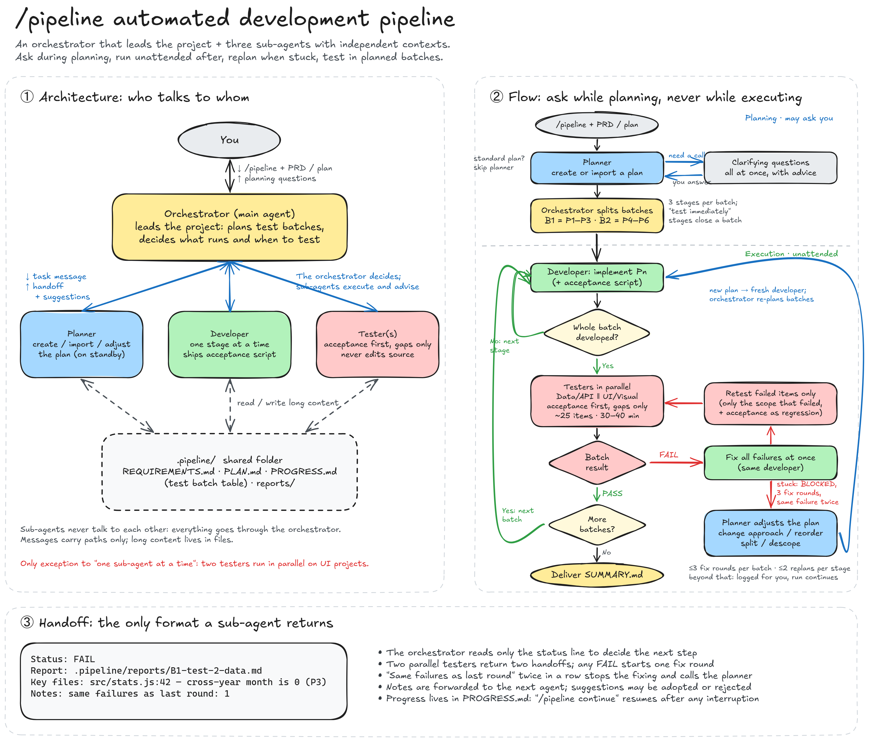

<div align="center">

# Claude Pipeline Skill

**One command turns a Claude Code session into an automated Plan → Develop → Test team.**

[](https://github.com/ELjagi623/claude-pipeline-skill/releases/latest)
[](https://docs.claude.com/en/docs/claude-code)

**English** | [简体中文](README.zh-CN.md)

[Install](#install) · [Install with an AI agent](#install-with-an-ai-agent) · [Usage](#usage) · [How it works](#how-it-works) · [Configuration](#configuration)

</div>

---

Type `/pipeline` and your current session becomes the **orchestrator**. Give it a PRD and a development plan and it builds straight from the plan; give it only requirements and a planner agent breaks them into stages first. The orchestrator then runs the whole show:

1. It splits the stages into **test batches** (3 stages per batch by default) right after the plan is final.
2. A developer agent implements the stages one by one.
3. Once a batch is fully developed, tester agents validate it in one pass.
4. Failures are fixed in a single round and only the failed items are retested.
5. If a stage stays stuck, the planner changes the approach or the order and the run continues until every stage is handled.

The orchestrator **leads the project**: when to develop, when to test, which scope, how many testers, and whether to accept a sub-agent's suggestion are all its calls. The three sub-agents only execute their own role and may offer suggestions. The orchestrator itself never writes business code, tests, or plans, and only maintains the progress records.

Each sub-agent has its own **independent context window**. Without `/pipeline`, none of this is active and your session behaves as usual.

<p align="center">
  
</p>

<p align="center"><sub>Editable source: <a href="docs/pipeline-diagram-en.excalidraw">docs/pipeline-diagram-en.excalidraw</a> (open it at <a href="https://excalidraw.com">excalidraw.com</a>)</sub></p>

## Features

- **Opt-in**: runs only when you type `/pipeline`; the model never triggers it on its own.
- **Orchestrator-led**: the main agent decides what happens and when. Sub-agents execute and advise; the orchestrator can adopt or reject their advice, and every call is logged in `DECISIONS.md`.
- **Role isolation**: the orchestrator only dispatches; the tester cannot modify source code, so validation stays independent.
- **Cheap, batched testing (v1.3.0)**: stages are grouped into test batches planned up front. Developers ship an `acceptance` script, testers only fill the gaps it leaves, and failures are retested selectively. See [Token-efficient testing](#token-efficient-testing).
- **Independent contexts**: each sub-agent works in its own conversation; the orchestrator only receives a four-line handoff.
- **Reuse with automatic rotation**: agents are reused to keep context. A sub-agent that detects its context was auto-compacted reports it, and the orchestrator swaps in a fresh one. Testers are reused within a batch and replaced between batches.
- **Resumable**: all state lives in `.pipeline/`, so `/pipeline continue` picks up where you left off, even in a new session.
- **Bring your own plan**: an existing PRD and plan are used as-is; the planner only fills in missing acceptance criteria and dependencies.
- **Ask during planning, never during execution**: clarifying questions come all at once, with recommended answers. After the plan is final the run is unattended; read `.pipeline/SUMMARY.md` when you are back.
- **Replans when stuck**: repeated failures trigger the planner to switch approach, reorder, split, or descope.
- **Bounded loops**: at most 3 fix rounds per test batch and 2 replans per stage; leftovers are recorded and the run moves on.

## Token-efficient testing

In real runs, testing agents consumed about 40% of all tokens, with single rounds taking 30–40 minutes. Developers had already written plenty of tests, yet testers rewrote an independent copy; testing went too deep (mutation checks, multi-timezone sweeps, running the whole suite many times); and every tester re-read the plan, old reports, and designs. v1.3.0 addresses this:

| Rule | What happens |
|---|---|
| Batches planned up front | After planning, the orchestrator groups stages into test batches (`TEST_BATCH = 3`) and records them in `PROGRESS.md`. A batch is tested only when all its stages are developed. A stage marked "test immediately" (high-risk foundations) closes its batch early. |
| `acceptance` script | Every developer ships a one-command script (for example `npm run acceptance`) that checks the acceptance criteria and prints a PASS/FAIL table. Gaps are listed as "not covered by acceptance". |
| Fill the gaps only | Testers run `acceptance` first, trust existing automated tests, and verify only what it does not cover. No mutation checks, no multi-timezone sweeps, no repeated full-suite runs. A suspected flaky case is re-run 3 times, alone. |
| Fixed checklist and budget | About 25 items per tester, each with "how to verify / pass criteria", within 30–40 minutes. On timeout the tester writes the report with unverified items marked. Reports contain only the PASS/FAIL table, failure details, and screenshot paths. |
| Parallel testers | For projects with a UI, a data/API tester and a UI/visual tester run at the same time. This is the one exception to "one sub-agent at a time". |
| Fix once, retest failures | Failures from the whole batch go to the developer in one round. Retests cover only the failed items, and only the scope that failed. |
| Batch-scoped reuse | Testers are reused across retests within a batch and replaced for the next batch. |

## Prerequisites

- [Claude Code](https://docs.claude.com/en/docs/claude-code) (CLI, desktop app, or IDE extension).
- `curl` (macOS / Linux) or PowerShell (Windows, built in) for the one-line install.

## Install

Files go to your user-level config directory `~/.claude/`, so one install works for every project. Existing files with the same names are backed up as `*.bak.<timestamp>` first.

### Option 1: one-line install (recommended)

**macOS / Linux**

```bash
curl -fsSL https://raw.githubusercontent.com/ELjagi623/claude-pipeline-skill/main/install.sh | bash
```

**Windows (PowerShell)**

```powershell
irm https://raw.githubusercontent.com/ELjagi623/claude-pipeline-skill/main/install.ps1 | iex
```

### Option 2: download a release

1. Download [claude-pipeline-skill.zip](https://github.com/ELjagi623/claude-pipeline-skill/releases/latest/download/claude-pipeline-skill.zip) and unzip it.
2. Run inside the extracted folder:
   - macOS / Linux: `bash install.sh`
   - Windows: `powershell -ExecutionPolicy Bypass -File .\install.ps1`

### Option 3: copy manually

| File in this repo | Copy to |
|---|---|
| `skills/pipeline/SKILL.md` | `~/.claude/skills/pipeline/SKILL.md` |
| `agents/pipeline-planner.md` | `~/.claude/agents/pipeline-planner.md` |
| `agents/pipeline-developer.md` | `~/.claude/agents/pipeline-developer.md` |
| `agents/pipeline-tester.md` | `~/.claude/agents/pipeline-tester.md` |

> [!TIP]
> To use it in a single project only, copy the four files into that project's `.claude/skills/pipeline/` and `.claude/agents/` instead.

> [!IMPORTANT]
> Start a **new Claude Code session** after installing so the skill and sub-agents are picked up.

## Install with an AI agent

Send this repository URL to Claude Code (or any agent that can run commands) and ask it to install it:

```text
Install this for me: https://github.com/ELjagi623/claude-pipeline-skill
```

### Instructions for AI agents

> If you are an AI agent reading this file because the user asked you to install this skill, follow these steps:

1. **Detect the OS** and run the matching one-liner (it downloads and installs 4 files into the user's Claude Code config directory):
   - macOS / Linux / Git Bash on Windows:
     `curl -fsSL https://raw.githubusercontent.com/ELjagi623/claude-pipeline-skill/main/install.sh | bash`
   - Windows PowerShell:
     `irm https://raw.githubusercontent.com/ELjagi623/claude-pipeline-skill/main/install.ps1 | iex`
2. **Verify** these 4 files exist (`~` is the home directory; if `CLAUDE_CONFIG_DIR` is set, use it instead of `~/.claude`):
   - `~/.claude/skills/pipeline/SKILL.md`
   - `~/.claude/agents/pipeline-planner.md`
   - `~/.claude/agents/pipeline-developer.md`
   - `~/.claude/agents/pipeline-tester.md`
3. If downloading is not possible, use [Option 3](#option-3-copy-manually): read the 4 files from this repository and write them to the paths in the table, backing up any existing file first.
4. **Tell the user** the install is done, that they must start a new Claude Code session, and then run `/pipeline <full requirements>`.
5. Do not edit these 4 files and do not run `/pipeline` unless the user asks.

## Usage

Open a new session in your project folder, then:

| Command | Effect |
|---|---|
| `/pipeline` | Finds the PRD and development plan in the project and starts the pipeline |
| `/pipeline <file paths…>` | Uses the given PRD / plan files, e.g. `/pipeline docs/PRD.md docs/plan.md` |
| `/pipeline <requirements>` | No files? Describe the requirements in plain text |
| `/pipeline status` | Shows progress (no agent is dispatched) |
| `/pipeline stop` | Pauses the run |
| `/pipeline continue` | Resumes from where it stopped, even in a new session |

> [!NOTE]
> The skill's argument keywords are the Chinese words `状态` (status), `停止` (stop), and `继续` (continue). Type those for the keyword commands; the skill's prompts are written in Chinese.

### Two ways to start

**A. Write the PRD and plan first (recommended).** Discuss the requirements in a separate chat, save a PRD and a development plan in the project (for example under `docs/`), then run:

```text
/pipeline
```

It finds both files (and asks which one to use if there are several candidates). If every stage in your plan already has verifiable acceptance criteria, it starts building right away; otherwise the planner only adds acceptance criteria and dependencies, without changing your stages or decisions.

**B. Requirements only.**

```text
/pipeline Build an expense tracker web page: add income and expenses, monthly summaries, data stored in the browser, plain HTML/CSS/JS, no backend.
```

The planner drafts the plan from scratch. The more specific the requirements (features, stack preferences, how to verify), the better the plan.

### Planning phase: a few questions at most

If the plan has questions that would **materially change the product**, they are asked all at once with a recommended answer each. Answer one by one, or reply "go with the recommendations". Once answered, the plan is finalized and execution starts automatically.

### Execution phase: no questions, safe to walk away

- **Decisions** follow the order "most complete > fewest defects > reliable and testable > easy to change later". Every decision and its reason is logged in `.pipeline/DECISIONS.md`.
- **Stuck stages** (the developer cannot proceed, 3 fix rounds still fail, or the same failure appears two rounds in a row) are stopped early and handed to the planner: change approach, postpone, split, or descope. Each stage is replanned at most twice.
- **Red lines**: anything that needs your accounts, keys, paid services, `git push`, deployment, or deleting files outside the project is never done for you. It builds what it can with mock data and placeholder config and lists the rest for you.
- **When it finishes**, open `.pipeline/SUMMARY.md` for how to run the result, per-stage outcomes, plan adjustments, items for you, and the key decisions made on your behalf.

> [!IMPORTANT]
> Before running overnight, make sure that:
> 1. Claude Code's permission mode is **auto**; otherwise it pauses for approvals.
> 2. Your computer will not go to sleep (use "keep awake" in the Claude desktop app, or disable sleep in system power settings).

## How it works

| Role | File | Responsibility |
|---|---|---|
| Orchestrator | `skills/pipeline/SKILL.md` | Leads the project: plans the test batches, decides what runs next and when to test, judges results, records progress, reports to you. Writes no code. |
| Planner | `agents/pipeline-planner.md` | On standby throughout: creates or imports the plan, and adjusts it (change approach / reorder / split / descope) when development gets stuck. |
| Developer | `agents/pipeline-developer.md` | Implements one stage at a time, ships the `acceptance` script, fixes failures at the root cause. |
| Tester | `agents/pipeline-tester.md` | Runs `acceptance`, fills the gaps within a fixed checklist and time budget, reports PASS / FAIL. Never edits source. |

Agents **pass paths, not content**: messages carry instructions and file paths, while plans and reports live in the project's `.pipeline/` folder. A finished sub-agent returns only a four-line handoff (status, report path, key files, notes).

```
.pipeline/
├─ REQUIREMENTS.md       PRD / requirements (copied verbatim; your original is untouched)
├─ PLAN_SOURCE.md        your plan, if you provided one
├─ QUESTIONS.md          clarifying questions and your answers
├─ PLAN.md               the staged plan the pipeline runs (stage IDs, dependencies, order)
├─ DECISIONS.md          decisions made on your behalf, with reasons
├─ PROGRESS.md           progress, test batch table, plan changes, leftovers (used to resume)
├─ SUMMARY.md            final delivery summary (read this first)
└─ reports/              per-stage dev reports and per-round, per-scope test reports
```

For the full architecture, communication protocol, context management, and design trade-offs, see the [design document](docs/设计说明.md) (Chinese).

## Configuration

| Parameter | Where | Default | Meaning |
|---|---|---|---|
| `MAX_FIX` | `SKILL.md` | 3 | Max fix rounds per test batch before the planner replans |
| `MAX_REPLAN` | `SKILL.md` | 2 | Max replans per stage before it is recorded as a leftover |
| `ROTATE_EVERY` | `SKILL.md` | 3 | Stages a developer serves before being replaced |
| `TEST_BATCH` | `SKILL.md` | 3 | Stages per test batch (a "test immediately" stage closes a batch early) |
| `model` | header of each agent file | `inherit` | For example set to `sonnet` to save cost |

The install scripts also honor two environment variables: `PIPELINE_REF` (branch or tag to download, default `main`) and `CLAUDE_CONFIG_DIR` (Claude Code config directory, default `~/.claude`).

## Update and uninstall

**Update**: rerun the install command; old files are backed up automatically.

**Uninstall**: remove these files and folders.

```bash
rm -rf ~/.claude/skills/pipeline ~/.claude/agents/pipeline-planner.md ~/.claude/agents/pipeline-developer.md ~/.claude/agents/pipeline-tester.md
```

> [!NOTE]
> Multi-stage, multi-round runs consume a lot of tokens, more so for larger projects. The rules live in prompts: models usually follow them, but they are not enforced in code. See [known limitations](docs/设计说明.md#10-已知限制) (Chinese).
