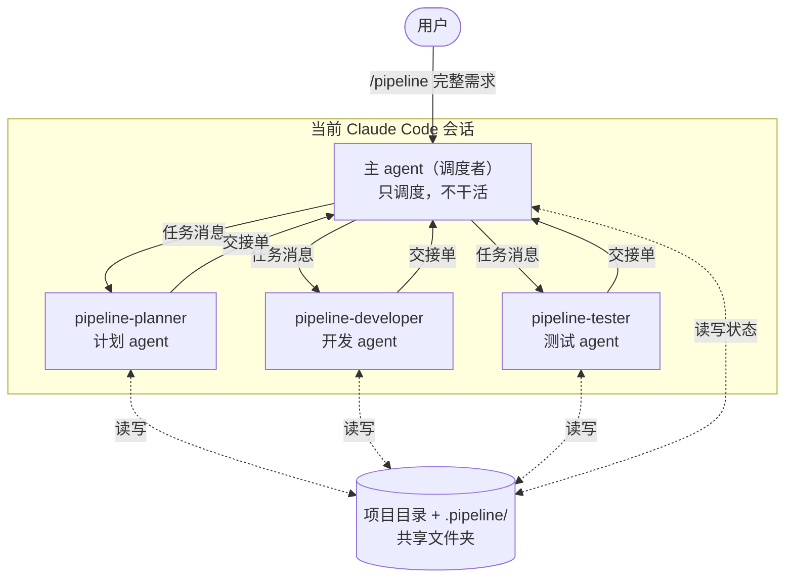
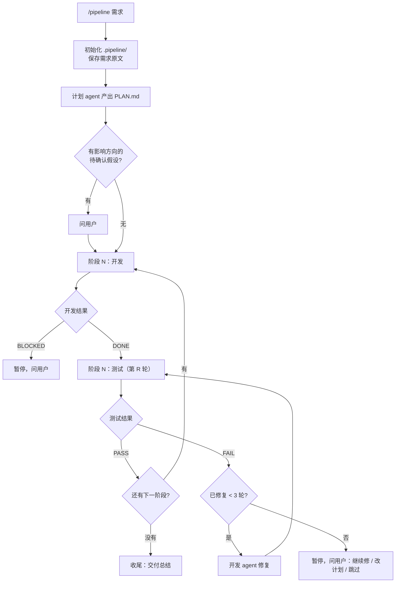

# Pipeline 工作流设计说明

> 一个基于 Claude Code 子 agent 的「计划 → 开发 → 测试」自动流水线。
> 本文说明它的整体架构、各角色职责、主 agent 与子 agent 之间如何通信，以及背后的设计取舍。

---

## 1. 它解决什么问题

把一个完整的项目需求交给 AI 一次性做完，通常会遇到三个问题：

1. **上下文混杂**：规划、写代码、测试的过程全挤在一个对话里，越往后越乱，模型容易忘事或自相矛盾。
2. **缺少独立验收**：写代码的人自己测自己，容易"自我感觉良好"。
3. **跑不长**：项目一大，上下文就会被塞满，中途一断就很难接上。

这套工作流的思路是**像一个小型开发团队那样分工**：一个只负责调度的"项目经理"，加上计划、开发、测试三个各自拥有独立上下文的"组员"，按阶段一步步推进，每一阶段都要经过独立测试才能进入下一阶段。

---

## 2. 整体架构



- **主 agent** 就是你输入 `/pipeline` 的那个会话本身。命令会加载 `SKILL.md`，让它切换成调度者身份。
- **三个子 agent** 都由主 agent 自动创建，不需要你手动开对话。每个子 agent 都有**独立的上下文窗口**，过程不会混进主 agent 的上下文。
- 所有 agent 在**同一个项目目录**里工作，`.pipeline/` 文件夹是它们之间交接长内容的地方。

---

## 3. 角色与职责

| 角色 | 文件 | 职责 | 能用的工具 | 明确禁止 |
|---|---|---|---|---|
| 调度者（主 agent） | `skills/pipeline/SKILL.md` | 派活、判定结果、记录进度、向用户汇报 | 全部（但按规则只用于调度） | 写业务代码、写测试、修 bug、改计划 |
| 计划 | `agents/pipeline-planner.md` | 读需求和现有代码，拆成按顺序执行的阶段，每个阶段写清范围和**可验证的验收标准** | Read, Grep, Glob, Bash, Write, WebSearch, WebFetch | 改项目源码 |
| 开发 | `agents/pipeline-developer.md` | 每次只实现一个阶段；根据测试报告找根因修复 | 全部 | 越界做后面阶段的事、改测试来绕过失败、改计划 |
| 测试 | `agents/pipeline-tester.md` | 逐条验证验收标准，跑回归测试，给出 PASS/FAIL | Read, Grep, Glob, Bash, Write | 修改任何源代码（只能写测试文件和报告） |

**为什么测试 agent 不能改源码？** 一旦它能改，就会倾向于"顺手修掉"问题，验收就不再独立了。发现问题只报告，修复交给开发，这样职责才清楚。

---

## 4. 执行流程



几个关键约束：

- **链式，不并发**：任何时刻只有一个子 agent 在运行。主 agent 派出一个，等它回来，再决定下一步。
- **每个阶段完成后，项目都应该能运行、能测试**：计划 agent 被要求先打地基，再做外围，后面的阶段只在前面的基础上叠加。
- **修复上限**：同一阶段修 3 轮（`MAX_FIX`）还不通过就停下来问人，避免无限循环烧 token。

---

## 5. 通信方式（核心）

### 5.1 三条通道 + 一个共享文件夹

| 方向 | 通道 | 传什么 |
|---|---|---|
| 主 → 子（新建） | 创建子 agent 时的 **initial prompt** | 任务、阶段、要读的文件路径、报告写到哪 |
| 主 → 子（复用） | **SendMessage** 发给已有的子 agent | 下一阶段任务，或失败报告的路径 |
| 子 → 主 | 子 agent 完成时的**最后一条回复** | 一张固定格式的**交接单** |
| 所有人之间 | **共享文件夹** `.pipeline/` | 需求原文、计划、进度、各阶段报告等长内容 |

两个天然限制，设计时要接受：

- **子 agent 之间不能直接对话**。开发和测试互不说话，所有信息都经过主 agent 转交（星型结构）。
- **子 agent 中途不能向主 agent 提问**，只能在完成时返回一次。所以遇到歧义，它要么做出合理假设并写进报告，要么返回 `BLOCKED`。

### 5.2 原则：传路径，不传全文

消息里只放**指令和文件路径**，长内容一律写进文件。原因：

- 主 agent 的上下文会随着每次返回不断累积。如果每个子 agent 都把几百行报告贴回来，主 agent 很快就会被塞满。
- 文件是持久的。上下文被压缩、会话中断、换新的子 agent，都能从文件里把信息找回来。
- 下游 agent 可以按需只读自己需要的部分，而不是被动接收一大段文本。

### 5.3 主 → 子：每条任务消息必须包含

1. 项目根目录、代码目录（如果代码在子文件夹里）
2. 任务类型（开发新阶段 / 修复 / 测试）
3. 阶段号和名称
4. 要读的文件路径（计划、进度、之前的报告）
5. 报告写入路径
6. 上游交接单里的「需要注意」

示例（复用开发 agent 进入新阶段）：

```
阶段 2 已通过测试。继续下一个任务。
任务类型：A. 开发新阶段
- 项目根目录：D:\projects\ledger（代码目录：.）
- 阶段：第 3 阶段「按月统计」（共 6 阶段）
- 先重新读一遍 .pipeline/PLAN.md 中的「阶段 3」，不要凭记忆
- 上游提醒：测试发现金额用浮点数存储，建议本阶段统一改为整数分
- 报告写入：.pipeline/reports/phase-3-dev.md
只做本阶段范围内的事。完成后按交接单格式返回。
```

### 5.4 子 → 主：交接单

所有子 agent 只能用这一种格式返回：

```
状态：DONE | BLOCKED | PASS | FAIL
报告：<报告文件路径>
关键文件：<路径>（新增/修改）—— 一句话说明；最多 5 条
需要注意：<给下游或调度者的提醒；没有就写"无">
```

示例（测试失败）：

```
状态：FAIL
报告：.pipeline/reports/phase-3-test-1.md
关键文件：src/stats.js:42 —— 跨年月份统计为 0；src/stats.js:57 —— 空数据时报错
需要注意：回归测试全部通过，只有本阶段新功能有问题
```

主 agent 的处理方式：

- **只根据「状态」行做流程决策**（进入下一阶段、修复、还是暂停）。
- 需要细节时（比如向用户解释失败原因），自己读报告文件的相关部分。
- 把开发的「需要注意」转交给测试，把测试的「需要注意」转交给开发，**让上下游通过主 agent 互相提醒**。
- 回复不符合格式时，让子 agent 按格式重发一次。

### 5.5 共享文件夹结构

```
.pipeline/
├─ REQUIREMENTS.md          需求原文（调度者写，原样保存）
├─ PLAN.md                  分阶段计划（计划 agent 写）
├─ PROGRESS.md              进度——唯一的真相来源（调度者写）
└─ reports/
   ├─ phase-1-dev.md        阶段 1 开发报告（开发 agent 写，修复时追加）
   ├─ phase-1-test-1.md     阶段 1 第 1 轮测试报告（测试 agent 写）
   ├─ phase-1-test-2.md     阶段 1 第 2 轮测试报告（复测）
   └─ ...
```

谁写什么是固定的：开发 agent 不能改 PLAN.md 和 PROGRESS.md，测试 agent 不能改源码，计划 agent 只写 `.pipeline/`。这样每份文件都只有一个负责人，不会互相覆盖。

---

## 6. 上下文管理

### 6.1 子 agent 复用与轮换

开发 agent 和测试 agent **默认跨阶段复用**：测完阶段一，阶段二继续发给同一个测试 agent，它记得已有的测试和回归范围；开发 agent 也记得自己写过的代码。

但主 agent **看不到子 agent 的上下文用了多少**，没法精确判断"快满了"。子 agent 快满时会自动压缩，不会撑爆，但压缩几次后细节会丢、质量会下降。所以用规则来轮换，满足任一条就新开一个同角色的 agent：

| 轮换条件 | 原因 |
|---|---|
| 已连续服务 3 个阶段（`ROTATE_EVERY`） | 主动防止上下文膨胀和反复压缩 |
| SendMessage 失败 / 找不到该 agent | agent 已不可用 |
| 回复显示它忘了内容、答非所问、质量下降 | 上下文已经退化 |
| 在新会话里用 `/pipeline 继续` 恢复 | 旧会话的 agent 带不过来 |

新开的 agent 没有历史，但它能读 `.pipeline/` 里的计划、进度和之前的报告，所以**轮换的成本很低**——这正是坚持"状态写文件"的回报。

为了抵消复用带来的惯性，两个 agent 的提示词都要求：**每个新阶段先重新读计划，不凭记忆**；测试 agent 还必须**从零验证，不能因为之前测过就默认没问题**。

### 6.2 主 agent 自己的上下文

- 子 agent 只回交接单（几行字），主 agent 的上下文增长很慢。
- 主 agent 每做完一步就更新 `PROGRESS.md`，里面记着当前阶段、当前步骤、"下一步做什么"和当前子 agent 的 id。
- 即使主 agent 的上下文被压缩，或者会话中断，它读一遍 PROGRESS.md 就能接着干；换一个新会话用 `/pipeline 继续` 也一样。

---

## 7. 开关设计

- `SKILL.md` 的头部设置了 `disable-model-invocation: true`：**只有用户亲手输入 `/pipeline` 才会触发**，模型不会自己决定启用。
- 三个子 agent 的描述里都写了"仅供 /pipeline 流水线调度使用，其他场景不要主动调用"，平时的会话不会误用它们。
- 所以不用 `/pipeline` 时，这套东西完全处于关闭状态；用的时候，输入一行命令就开启。

| 命令 | 作用 |
|---|---|
| `/pipeline <完整需求>` | 开启新流水线 |
| `/pipeline 状态` | 只看进度，不派活 |
| `/pipeline 停止` | 暂停，记录到 PROGRESS.md |
| `/pipeline 继续` | 从 PROGRESS.md 记录的下一步恢复 |

---

## 8. 什么时候会停下来找人

正常情况下它会一路自动跑完。以下几种情况会暂停，等用户决定：

1. 计划里有会明显影响方向的假设，需要确认。
2. 开发 agent 认为计划本身行不通，返回 `BLOCKED`。
3. 某阶段修了 3 轮仍不通过。
4. 用户中途插话修改需求（会先暂停、确认，再把修改追加到 REQUIREMENTS.md）。
5. 权限模式不是 auto 时，遇到需要审批的操作。

---

## 9. 可调参数

| 参数 | 位置 | 默认值 | 说明 |
|---|---|---|---|
| `MAX_FIX` | `SKILL.md` 铁律第 5 条 | 3 | 每阶段最多修复轮数 |
| `ROTATE_EVERY` | `SKILL.md` 复用规则 | 3 | 子 agent 连续服务几个阶段后换新 |
| `model` | 各 agent 文件头部 | `inherit` | 可改成 `sonnet` / `haiku` 等以节省成本 |
| `tools` | 各 agent 文件头部 | 见第 3 节 | 限制子 agent 能用的工具 |

---

## 10. 已知限制

- **成本**：多阶段、多轮测试会消耗较多 token，项目越大越明显。
- **约束是"软"的**：调度者"不干活"、测试"不改源码"等规则写在提示词里，模型通常会遵守，但不是代码级强制（测试 agent 的工具已经去掉了 Edit，算是部分硬限制）。
- **主 agent 无法感知子 agent 的上下文用量**，只能靠规则轮换。
- **子 agent 之间无法直接通信**，也不能中途提问，信息交接都经过主 agent 和文件。
- **计划质量决定上限**：如果需求本身模糊，计划 agent 只能做假设，建议在需求里尽量写清楚功能、技术栈偏好和验收方式。
