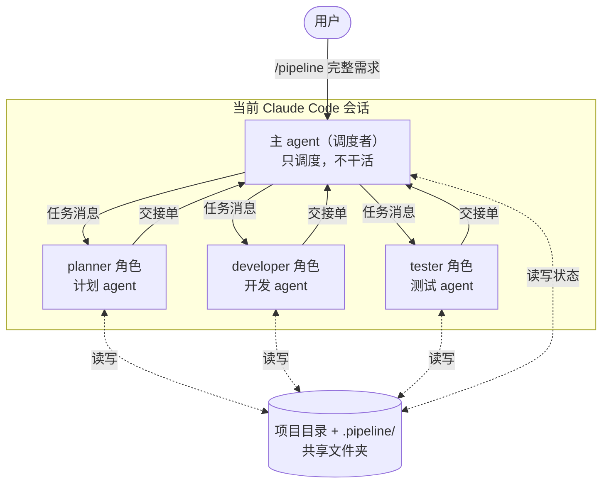
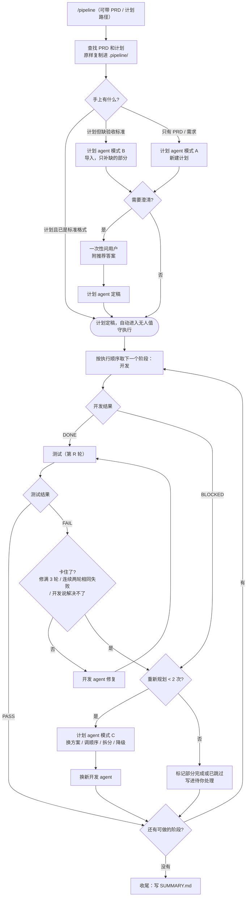

# Pipeline 工作流设计说明

> 一个基于 Claude Code 子 agent 的「计划 → 开发 → 测试」自动流水线。
> 本文说明它的整体架构、各角色职责、主 agent 与子 agent 之间如何通信，以及背后的设计取舍。

---

## 1. 它解决什么问题

把一个完整的项目需求交给 AI 一次性做完，通常会遇到三个问题：

1. **上下文混杂**：规划、写代码、测试的过程全挤在一个对话里，越往后越乱，模型容易忘事或自相矛盾。
2. **缺少独立验收**：写代码的人自己测自己，容易"自我感觉良好"。
3. **跑不长**：项目一大，上下文就会被塞满，中途一断就很难接上。

这套工作流的思路是**像一个小型开发团队那样分工**：一个只负责调度的"项目经理"，加上计划、开发、测试三个各自拥有独立上下文的"组员"，按阶段一步步推进，每一阶段都要经过独立测试才能进入下一阶段。

---

## 2. 整体架构



- **主 agent** 就是你输入 `/pipeline` 的那个会话本身。命令会加载 `SKILL.md`，让它切换成调度者身份。
- **三个子 agent** 都由主 agent 自动创建，不需要你手动开对话。每个子 agent 都有**独立的上下文窗口**，过程不会混进主 agent 的上下文。
- 所有 agent 在**同一个项目目录**里工作，`.pipeline/` 文件夹是它们之间交接长内容的地方。

---

## 3. 角色与职责

| 角色 | 文件 | 职责 | 能用的工具 | 明确禁止 |
|---|---|---|---|---|
| 调度者（主 agent） | `skills/pipeline/SKILL.md` | 派活、判定结果、记录进度、向用户汇报 | 全部（但按规则只用于调度） | 写业务代码、写测试、修 bug、改计划 |
| 计划 | `skills/pipeline/roles/planner.md` | **全程待命**。A 新建：从 PRD 拆出按顺序执行的阶段，每个阶段写清范围、依赖和**可验证的验收标准**；B 导入：把用户的计划转成标准格式，只补缺的部分；C 调整：开发卡住时换方案、调整顺序、拆分或降级 | 通用子 agent（靠提示词约束） | 改项目源码、改用户的 PRD 和计划原文、在执行阶段提问 |
| 开发 | `skills/pipeline/roles/developer.md` | 每次只实现一个阶段；根据测试报告找根因修复 | 全部 | 越界做后面阶段的事、改测试来绕过失败、改计划 |
| 测试 | `skills/pipeline/roles/tester.md` | 逐条验证验收标准，跑回归测试，给出 PASS/FAIL | 通用子 agent（靠提示词约束） | 修改任何源代码（只能写测试文件和报告） |

**为什么测试 agent 不能改源码？** 一旦它能改，就会倾向于"顺手修掉"问题，验收就不再独立了。发现问题只报告，修复交给开发，这样职责才清楚。

**为什么角色放在 skill 目录，而不是注册成全局子 agent？**（v1.3.1）全局子 agent 的描述会出现在每个会话里，模型遇到普通的开发 / 测试请求时可能自动选它们，没输入 `/pipeline` 也会被派出去。现在三个角色只是 `skills/pipeline/roles/` 下的文件，调度者派出通用子 agent 并让它先读对应角色文件；没有 `/pipeline` 时系统里没有任何 pipeline 角色可被选中。代价是测试角色失去了工具层面"不能改源码"的硬限制，改为靠提示词约束，并由调度者在每次派测试时重申。

---

## 4. 执行流程



几个关键约束：

- **链式，不并发**：任何时刻只有一个子 agent 在运行。主 agent 派出一个，等它回来，再决定下一步。
- **每个阶段完成后，项目都应该能运行、能测试**：计划 agent 被要求先打地基，再做外围，后面的阶段只在前面的基础上叠加。
- **两个阶段**：只有规划阶段可以问用户（流程图里的"问用户"节点只在定稿之前），执行阶段一个问题都不问，详见第 8 节。
- **按执行顺序和依赖推进**：阶段用固定 ID（P1、P2……），每个阶段写明依赖。调整顺序时，主 agent 只取依赖都已完成的阶段来做。
- **两层上限**：每个阶段最多修 3 轮（`MAX_FIX`）、最多重新规划 2 次（`MAX_REPLAN`）。到上限就接受现状、记录遗留问题、继续其他阶段，避免无限循环烧 token。

---

## 5. 通信方式（核心）

### 5.1 三条通道 + 一个共享文件夹

| 方向 | 通道 | 传什么 |
|---|---|---|
| 主 → 子（新建） | 创建子 agent 时的 **initial prompt** | 任务、阶段、要读的文件路径、报告写到哪 |
| 主 → 子（复用） | **SendMessage** 发给已有的子 agent | 下一阶段任务，或失败报告的路径 |
| 子 → 主 | 子 agent 完成时的**最后一条回复** | 一张固定格式的**交接单** |
| 所有人之间 | **共享文件夹** `.pipeline/` | 需求原文、计划、进度、各阶段报告等长内容 |

两个天然限制，设计时要接受：

- **子 agent 之间不能直接对话**。开发和测试互不说话，所有信息都经过主 agent 转交（星型结构）。
- **子 agent 中途不能向主 agent 提问**，只能在完成时返回一次。所以遇到歧义，它按最优标准自己决定并写进报告和 DECISIONS.md；确实做不下去才返回 `BLOCKED`。唯一的例外是规划阶段的计划 agent：它可以把问题写进 `QUESTIONS.md` 并返回 `NEEDS_INPUT`，由主 agent 转问用户。

### 5.2 原则：传路径，不传全文

消息里只放**指令和文件路径**，长内容一律写进文件。原因：

- 主 agent 的上下文会随着每次返回不断累积。如果每个子 agent 都把几百行报告贴回来，主 agent 很快就会被塞满。
- 文件是持久的。上下文被压缩、会话中断、换新的子 agent，都能从文件里把信息找回来。
- 下游 agent 可以按需只读自己需要的部分，而不是被动接收一大段文本。

### 5.3 主 → 子：每条任务消息必须包含

1. 项目根目录、代码目录（如果代码在子文件夹里）
2. 产品背景：`.pipeline/REQUIREMENTS.md`（PRD），让子 agent 知道这个产品在做什么
3. 任务类型（开发新阶段 / 修复 / 测试；计划 agent 是新建 / 导入 / 调整）
4. 阶段 ID 和名称
5. 要读的文件路径（计划、进度、之前的报告）
6. 报告写入路径
7. 上游交接单里的「需要注意」

示例（复用开发 agent 进入新阶段）：

```
上一个阶段已处理完。继续下一个任务。
任务类型：A. 开发新阶段
- 项目根目录：D:\projects\ledger（代码目录：.）
- 产品背景：.pipeline/REQUIREMENTS.md
- 阶段：P3「按月统计」（共 6 个阶段）
- 先重新读一遍 .pipeline/PLAN.md 中的「P3」，不要凭记忆（计划可能已被调整）
- 上游提醒：测试发现金额用浮点数存储，建议本阶段统一改为整数分
- 报告写入：.pipeline/reports/P3-dev.md
只做本阶段范围内的事。完成后按交接单格式返回。
```

### 5.4 子 → 主：交接单

所有子 agent 只能用这一种格式返回：

```
状态：DONE | BLOCKED | PASS | FAIL | NEEDS_INPUT
报告：<报告文件路径>
关键文件：<路径>（新增/修改）—— 一句话说明；最多 5 条
需要注意：<给下游或调度者的提醒；没有就写"无">
```

`NEEDS_INPUT` 只有计划 agent 在规划阶段可以用，表示问题已写进 `QUESTIONS.md`，需要问用户。

示例（复测仍失败）：

```
状态：FAIL
报告：.pipeline/reports/P3-test-2.md
关键文件：src/stats.js:42 —— 跨年月份统计为 0；src/stats.js:57 —— 空数据时报错
需要注意：与上一轮相同的失败：1 条（跨年月份统计为 0）；回归测试全部通过
```

主 agent 的处理方式：

- **只根据「状态」行做流程决策**（进入下一阶段、修复、重新规划还是跳过）。测试交接单里的"与上一轮相同的失败"用来判断修复有没有进展：连续两轮都不为 0，就判定为卡住。
- 需要细节时（比如向用户解释失败原因），自己读报告文件的相关部分。
- 把开发的「需要注意」转交给测试，把测试的「需要注意」转交给开发，**让上下游通过主 agent 互相提醒**。
- 回复不符合格式时，让子 agent 按格式重发一次。

### 5.5 共享文件夹结构

```
.pipeline/
├─ REQUIREMENTS.md          PRD / 需求原文（调度者从用户文件原样复制）
├─ PLAN_SOURCE.md           用户提供的计划原文（调度者原样复制；没有就不建）
├─ QUESTIONS.md             规划阶段的澄清问题（计划 agent 写）和用户的回答（调度者追加）
├─ PLAN.md                  流水线使用的计划：阶段 ID、依赖、执行顺序、验收标准（计划 agent 写）
├─ DECISIONS.md             自行决策记录（计划 / 开发 agent 和调度者追加）
├─ PROGRESS.md              进度——唯一的真相来源，含计划调整记录、遗留问题和「待你处理」（调度者写）
├─ SUMMARY.md               最终交付总结（调度者收尾时写）
└─ reports/
   ├─ P1-dev.md             P1 开发报告（开发 agent 写，修复时追加）
   ├─ P1-test-1.md          P1 第 1 轮测试报告（测试 agent 写）
   ├─ P1-test-2.md          P1 第 2 轮测试报告（复测）
   └─ ...
```

谁写什么是固定的：开发 agent 不能改 PLAN.md 和 PROGRESS.md，测试 agent 不能改源码，计划 agent 只写 `.pipeline/`，而且不改 REQUIREMENTS.md 和 PLAN_SOURCE.md。用户自己的 PRD 和计划原文件谁都不改。这样每份文件都只有一个负责人，不会互相覆盖。

阶段 ID（P1、P2……）一旦定下就不再改，拆分出来的阶段用 P3a、P3b。这样调整执行顺序后，报告文件名和进度记录依然对得上。

---

## 6. 上下文管理

### 6.1 子 agent 复用与轮换

开发 agent 和测试 agent **默认跨阶段复用**：测完阶段一，阶段二继续发给同一个测试 agent，它记得已有的测试和回归范围；开发 agent 也记得自己写过的代码。

但主 agent **看不到子 agent 的上下文用了多少**，没法精确判断"快满了"。子 agent 快满时会自动压缩，不会撑爆，但压缩几次后细节会丢、质量会下降。

最准确的信号来自子 agent 自己：被压缩后，它的对话开头会变成一段"之前对话的摘要"。三个子 agent 的提示词都要求：发现这种情况，当前任务照常做完（涉及之前的内容一律重新读文件），并在交接单「需要注意」里写"上下文已被压缩"。主 agent 看到这句，就在下一个任务换一个新的 agent。这样在质量下降**之前**就能换掉，而不是等到它出错。

再加上几条按规则的兜底，满足任一条就新开一个同角色的 agent：

| 轮换条件 | 原因 |
|---|---|
| 子 agent 报告"上下文已被压缩" | 实际发生了压缩，细节可能已丢，下一个任务交给新 agent |
| 已连续服务 3 个阶段（`ROTATE_EVERY`） | 主动防止上下文膨胀和反复压缩 |
| SendMessage 失败 / 找不到该 agent | agent 已不可用 |
| 回复显示它忘了内容、答非所问、质量下降 | 上下文已经退化 |
| 在新会话里用 `/pipeline 继续` 恢复 | 旧会话的 agent 带不过来 |
| 某个阶段的计划被调整过（仅开发 agent） | 新方案交给新的开发 agent，避免被旧思路带偏 |

计划 agent 不参与轮换，**全程待命**：开头规划用它，之后每次卡住都回来找它。它记得整个计划的来龙去脉，所以能复用就复用，找不到才新开。

新开的 agent 没有历史，但它能读 `.pipeline/` 里的计划、进度和之前的报告，所以**轮换的成本很低**——这正是坚持"状态写文件"的回报。

为了抵消复用带来的惯性，两个 agent 的提示词都要求：**每个新阶段先重新读计划，不凭记忆**；测试 agent 还必须**从零验证，不能因为之前测过就默认没问题**。

### 6.2 主 agent 自己的上下文

- 子 agent 只回交接单（几行字），主 agent 的上下文增长很慢。
- 主 agent 每做完一步就更新 `PROGRESS.md`，里面记着当前阶段、当前步骤、"下一步做什么"和当前子 agent 的 id。
- 即使主 agent 的上下文被压缩，或者会话中断，它读一遍 PROGRESS.md 就能接着干；换一个新会话用 `/pipeline 继续` 也一样。

---

## 7. 开关设计

- `SKILL.md` 的头部设置了 `disable-model-invocation: true`：**只有用户亲手输入 `/pipeline` 才会触发**，模型不会自己决定启用。
- 三个子 agent 的描述里都写了"仅供 /pipeline 流水线调度使用，其他场景不要主动调用"，平时的会话不会误用它们。
- 所以不用 `/pipeline` 时，这套东西完全处于关闭状态；用的时候，输入一行命令就开启。

| 命令 | 作用 |
|---|---|
| `/pipeline` | 自动查找项目里的 PRD 和开发计划，开启流水线 |
| `/pipeline <文件路径…>` | 指定 PRD / 计划文件开启流水线 |
| `/pipeline <完整需求>` | 没有文件时，用文字需求开启流水线 |
| `/pipeline 状态` | 只看进度，不派活 |
| `/pipeline 停止` | 暂停，记录到 PROGRESS.md |
| `/pipeline 继续` | 从 PROGRESS.md 记录的下一步恢复 |

---

## 8. 两个阶段：规划可交互，执行无人值守

推荐的用法是：先在另一个对话里把需求讨论清楚，写好 PRD 和开发计划，再启动 `/pipeline`。所以流程分成两个阶段：

- **规划阶段**（启动 → 计划定稿）：用户刚启动，通常还在旁边。这时候有需要用户拍板的事，问清楚比让 AI 猜更好。
- **执行阶段**（计划定稿之后）：用户可能已经去睡觉了，没有人会回答问题，所以调度者和三个子 agent **都不向用户提问、不等待确认**。

主 agent 把当前阶段记在 PROGRESS.md 的「模式」里，上下文压缩后也不会搞混。

### 8.1 规划阶段：找文件、导入计划、集中提问

**找 PRD 和计划**：用户可以在命令后面直接给路径；不给就自动在项目根目录、`docs/`、`.pipeline/` 下按文件名查找（PRD、需求、requirements、spec / plan、计划、开发计划、roadmap）。同一类找到多个候选时，问用户用哪个。找到的文件**原样复制**进 `.pipeline/`，用户的原文件不改。

**三种情形**：

| 有什么 | 怎么做 |
|---|---|
| 计划已是标准格式（每个阶段都有 ID、依赖、可验证的验收标准） | 直接使用，跳过计划 agent |
| 有计划，但缺验收标准等 | 计划 agent 模式 B 导入：保留用户的阶段划分和决策，只补缺的部分 |
| 只有 PRD 或文字需求 | 计划 agent 模式 A 从零新建 |

**集中提问**：计划 agent 只问会实质改变产品的问题，技术细节自己决定。问题一次性写进 `QUESTIONS.md`，每题附选项、推荐答案和"为什么重要"，并先按推荐答案把计划草稿写好。主 agent 把问题列给用户；用户可以逐题回答，也可以回复"按推荐来"。最多再追问 1 轮。回答完计划就定稿，**自动进入执行阶段**，不用用户再说"开始"。

### 8.2 执行阶段：遇到选择怎么办

自己选最优方案，标准按优先级：

1. 功能最完整、最贴合需求原意；
2. 缺陷最少、最稳定；
3. 实现可靠、可测试（优先成熟、常见的技术）；
4. 将来容易调整。

同等条件下选更简单的。每个决策都记进 `DECISIONS.md`（问题、候选方案、选择、理由），用户醒来可以逐条复核。

### 8.3 执行阶段：卡住了怎么办

修复循环最怕的是"一直修、一直不过"，白白烧 token。所以主 agent 会**及时叫停**。满足以下任一条件就算卡住：

| 卡住的信号 | 从哪里看出来 |
|---|---|
| 开发 agent 返回 `BLOCKED` | 交接单的状态行 |
| 修了 3 轮（`MAX_FIX`）仍是 FAIL | 测试轮数 |
| 连续两轮出现相同的失败（修了也没进展） | 测试交接单里的"与上一轮相同的失败：N 条" |
| 开发 agent 说同一个问题解决不了、建议换方案 | 开发交接单的「需要注意」 |

卡住后，主 agent 停止修复，把开发报告、各轮测试报告和失败历史交给计划 agent（模式 C）。计划 agent 先弄清楚卡在哪，再选最合适的调整方式（可以组合），直接改 PLAN.md：

| 调整方式 | 适用情况 |
|---|---|
| **换技术方案** | 现在的做法行不通（库不支持、思路有缺陷） |
| **调整顺序** | 卡在依赖没准备好，或者暂时绕不过去：先推迟它，做不依赖它的其他阶段，之后再回来 |
| **拆分** | 阶段太大，一部分能做、一部分卡住：拆成 P3a、P3b，先做能做的 |
| **降级** | 确实做不到：缩小范围，保留核心功能，其余写进「需要用户后续处理」 |

调整后，主 agent 同步执行顺序，**换一个新的开发 agent** 执行新方案，继续推进。每个阶段最多重新规划 2 次（`MAX_REPLAN`，推迟后回来重试也计入）；还不行就标为「部分完成」或「已跳过」，写进「待你处理」，继续做其他阶段。每次调整都记在「计划调整记录」里，最后汇总进 SUMMARY.md。

### 8.4 其他原来会停下来的地方

| 情况 | 处理方式 |
|---|---|
| 执行中遇到需求歧义 | 子 agent 按最优标准自行决定，记入 DECISIONS.md |
| 某阶段依赖的阶段被跳过 | 本阶段也跳过，写进「待你处理」，其余阶段照常推进 |
| 启动时 `.pipeline/` 已有旧进度 | 来源内容相同就继续；不同就把旧文件夹改名为 `.pipeline.bak-<时间戳>` 保留，再重新开始 |
| 用户中途插话修改需求 | 用户此时在场，直接采纳：追加到 REQUIREMENTS.md，让计划 agent 更新尚未开始的阶段，然后继续 |

### 8.5 红线：不替用户做的事

以下事情不由 AI 决定，也不执行。遇到时先用替代方案完成能做的部分，再把它们列进「待你处理」：

- 需要用户本人的账号、API 密钥、付费服务或个人信息（替代：本地模拟数据、mock 接口、`.env.example` 占位配置）；
- git push、发布、部署到任何外部环境，或任何对外发送的操作；
- 删除或覆盖项目目录以外的文件，或删除项目里用户原有的数据；
- 花钱、安装需要管理员权限的系统级软件。

### 8.6 醒来看什么

全部阶段处理完后，调度者会写 `.pipeline/SUMMARY.md`，内容包括：怎么运行、各阶段结果（完成 / 部分完成 / 已跳过）、计划调整记录、按重要程度排好序的「待你处理」、已知遗留问题，以及替你做的关键决策。

### 8.7 流程之外仍可能卡住的情况

这两种情况不归 skill 控制，需要运行前设置好：

1. **权限审批**：权限模式不是 auto 时，遇到需要审批的操作会停下来等人点。
2. **电脑睡眠**：电脑睡着后会话就会中断。可以在 Claude 桌面版里打开「保持唤醒」，或者在系统电源设置里关闭睡眠。中断后用 `/pipeline 继续` 可以接着跑。

---

## 9. 可调参数

| 参数 | 位置 | 默认值 | 说明 |
|---|---|---|---|
| `MAX_FIX` | `SKILL.md` 铁律第 5 条 | 3 | 每阶段最多修复轮数，到了就交给计划 agent 重新规划 |
| `MAX_REPLAN` | `SKILL.md` 铁律第 5 条 | 2 | 每阶段最多重新规划次数，到了就记为遗留问题 |
| `ROTATE_EVERY` | `SKILL.md` 复用规则 | 3 | 子 agent 连续服务几个阶段后换新 |
| `TEST_BATCH` | `SKILL.md` 测试提效规则 | 3 | 每几个阶段划为一个测试批次，由主 agent 在计划定稿后划分 |
| `model` | 各 agent 文件头部 | `inherit` | 可改成 `sonnet` / `haiku` 等以节省成本 |
| `tools` | 各 agent 文件头部 | 见第 3 节 | 限制子 agent 能用的工具 |

---

## 10. 已知限制

- **成本**：多阶段、多轮测试会消耗较多 token，项目越大越明显。
- **约束是"软"的**：调度者"不干活"、测试"不改源码"等规则写在提示词里，模型通常会遵守，但不是代码级强制（测试 agent 的工具已经去掉了 Edit，算是部分硬限制）。
- **主 agent 无法感知子 agent 的上下文用量**，只能靠规则轮换。
- **子 agent 之间无法直接通信**，也不能中途提问，信息交接都经过主 agent 和文件。
- **计划质量决定上限**：如果需求本身模糊，计划 agent 只能做假设，建议在需求里尽量写清楚功能、技术栈偏好和验收方式。

## 附：测试提效（v1.3.0）
实测发现测试 agent 占总 token 约 40%、单次 30–40 分钟：开发者已写大量测试，测试者又重写一套；测得过深；每个测试 agent 开工前都重读计划、报告和设计稿；没有清单和时间上限。v1.3.0 的对策：

1. **主 agent 主导、批次提前规划**：计划定稿后，主 agent 按执行顺序、依赖和「立即测试」标记，把阶段划分成测试批次（默认每 3 个阶段一批），写进 PROGRESS.md 的「测试批次表」；一批开发完才测，计划调整后由主 agent 重划。什么时候测、测什么范围、派几个测试 agent、是否采纳子 agent 的建议，全部由主 agent 决定；主 agent 自己只写调度记录，不替子 agent 写清单或报告。
2. **开发者交付 acceptance 脚本**：自动核对验收标准并输出 PASS/FAIL 表，后续阶段追加；覆盖不了的列为「acceptance 未覆盖项」。
3. **测试者只补缺口**：先跑 acceptance；禁止变异检验、多时区穷举、整套连跑；怀疑偶发只重跑失败用例 3 次。
4. **固定清单 + 预算**：约 25 项、30–40 分钟，超时先出报告并标注未测项；报告只含结果表、失败详情、截图路径。计划 agent 把每条验收标准写成「类型 / 怎么验 / 通过标准」。
5. **并行测试**：有界面的项目同时派「数据与接口」「界面与视觉」两个测试 agent（"链式不并发"的唯一例外）。
6. **集中修复、只复测失败项**；测试 agent 批内续用、换批次才换。
